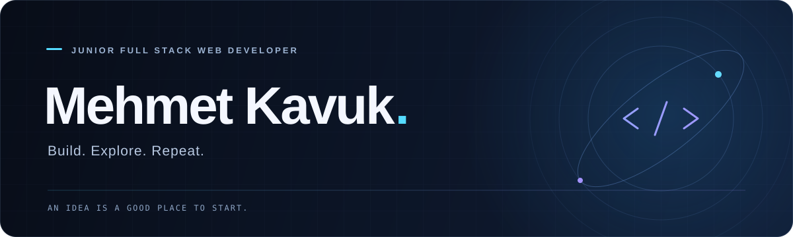

  

  <strong>Web interfaces. Desktop tools. Practical ideas.</strong> 
  I'm Mehmet, a junior full stack web developer based in Türkiye. 
  My projects span Vue.js interfaces, database applications, and desktop utilities.

  <a href="https://github.com/mehmetkvk12?tab=repositories">Explore my projects</a>
  &nbsp; · &nbsp;
  <a href="https://www.linkedin.com/in/mehmet-kavuk-47a5a0306/">Connect on LinkedIn</a>

---

### Selected projects

| Project | What it does | Built with |
| :--- | :--- | :--- |
| **[Vue Dashboard](https://github.com/mehmetkvk12/vuejsProject)** | A login interface and administration dashboard. | `Vue.js` `TypeScript` |
| **[Market Automation](https://github.com/mehmetkvk12/market-barkod-sistemi)** | Inventory tracking, sales transactions, and product management. | `VB.NET` `SQL Server` |
| **[QR Code Generator](https://github.com/mehmetkvk12/QRKod)** | Generate, preview, customize, and save QR codes from a desktop app. | `VB.NET` |

### Technologies in my projects

**Web** &nbsp; `Vue.js` · `TypeScript` · `PHP` 
**Desktop & data** &nbsp; `VB.NET` · `SQL Server` 
**Development** &nbsp; `Visual Studio` · `GitHub`

---

  Start with an idea. Make something of it.

